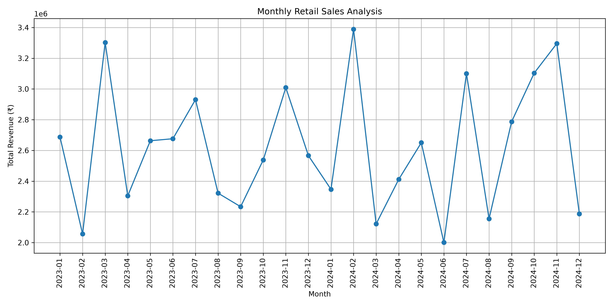
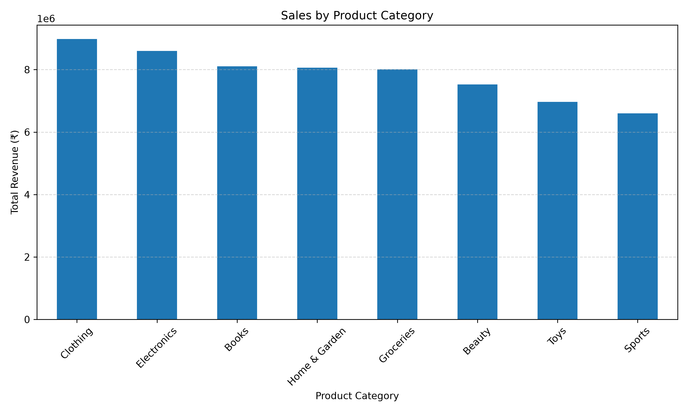
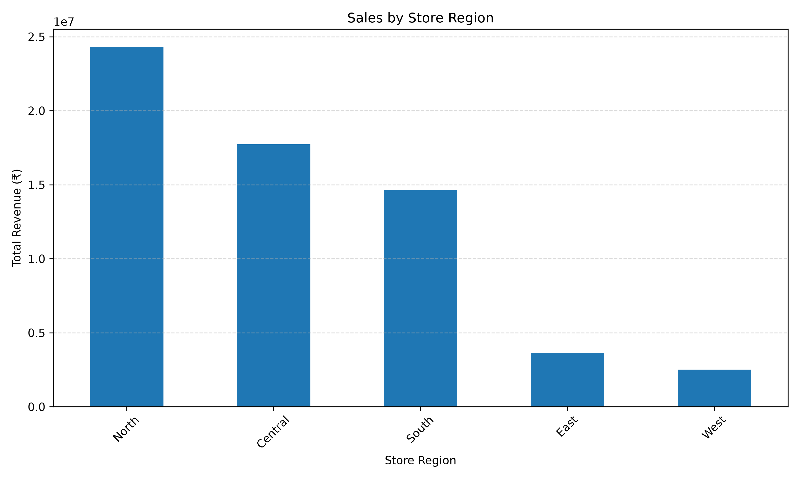
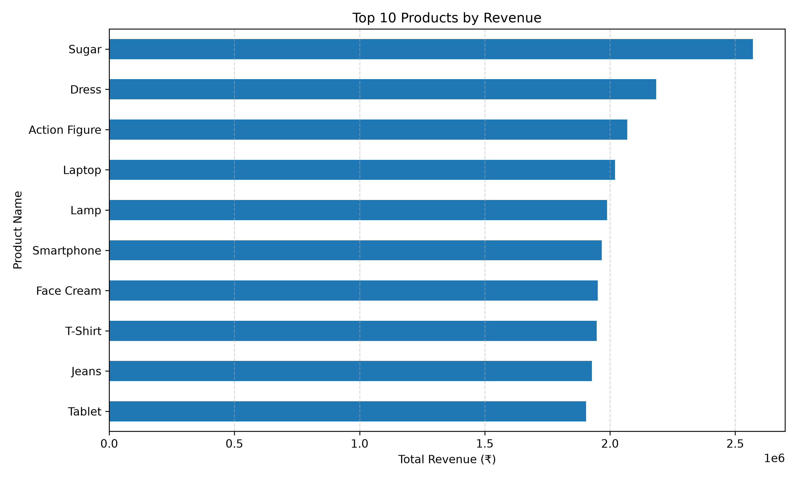

# Retail Sales Analysis Project

## Project Overview
This project analyzes retail sales data using Python, Pandas, and Matplotlib to identify sales trends, top-performing product categories, regional performance, and high-revenue products.

## Tools and Technologies
- **Python** – Data analysis and calculations
- **Pandas** – Data cleaning and manipulation
- **Matplotlib** – Data visualization and charts
- **MySQL** – SQL queries and sales analysis
- **CSV Dataset** – Retail sales data
- **VS Code** – Development environment

## Dataset
- Original records: 1,000
- Cleaned records: 999
- Columns: 9 original dataset columns

## Data Cleaning
- Identified and removed rows containing missing values.
- Converted the date column into datetime format.
- Validated revenue calculations using units sold, unit price, and discount percentage.
- Exported the cleaned dataset to CSV.

## Analysis Performed
1. Monthly sales analysis
2. Product category sales analysis
3. Store region sales analysis
4. Top 10 products by revenue
5. Key business insights

## Key Findings
- Total revenue: ₹6,28,35,646.09
- Total units sold: 1,01,072
- Highest-revenue category: Clothing
- Highest-revenue region: North
- Highest-revenue product: Sugar
- Highest monthly revenue: February 2024 — ₹33,88,946.15
- Lowest monthly revenue: June 2024 — ₹20,00,831.05

## Project Outputs
- `outputs/monthly_sales.png`
- `outputs/category_sales.png`
- `outputs/region_sales.png`
- `outputs/top_products.png`

## How to Run
1. Install the required libraries:
   `pip install pandas matplotlib`
2. Open the project folder in VS Code.
3. Run the Python scripts from the project root:
   `python src/load_data.py`
   `python src/monthly_sales.py`
   `python src/monthly_sales_chart.py`
   `python src/category_sales.py`
   `python src/region_sales.py`
   `python src/top_products.py`
   `python src/business_insights.py`

## Data Visualizations
### 1. Monthly Sales Analysis

### 2. Sales by Product Category

### 3. Sales by Region

### 4. Top-Selling Products

## Conclusion
This project demonstrates the use of Python, Pandas, Matplotlib, and MySQL to clean, analyze, and visualize retail sales data. The analysis identified key sales trends across product categories, regions, and months, helping highlight high-performing products and business areas.
